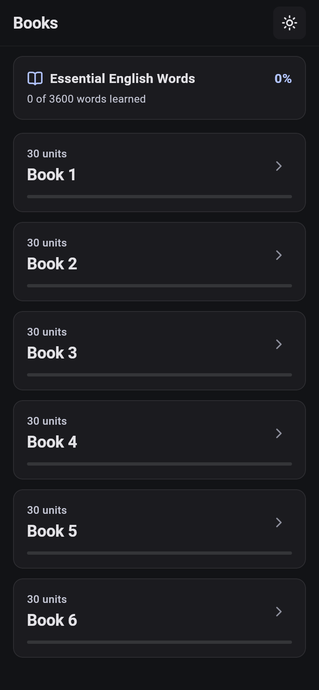
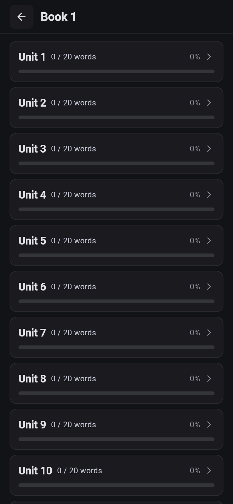
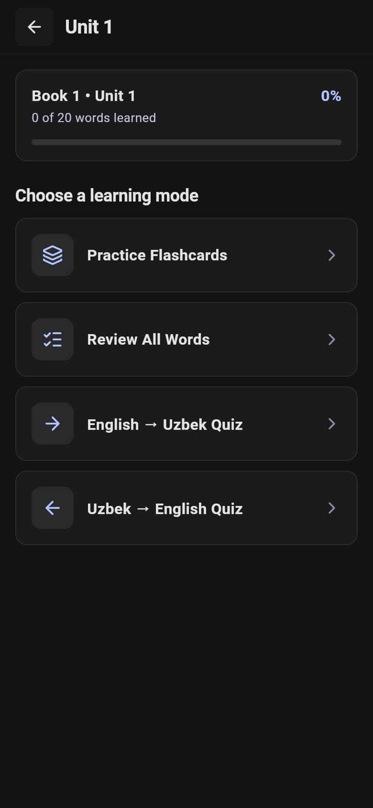
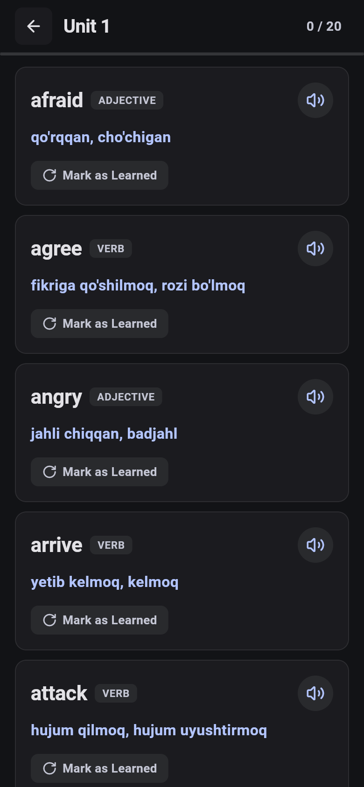
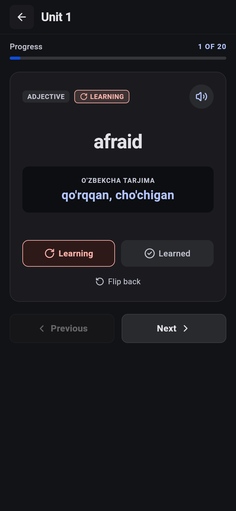
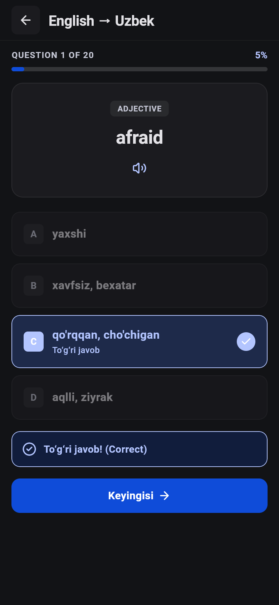
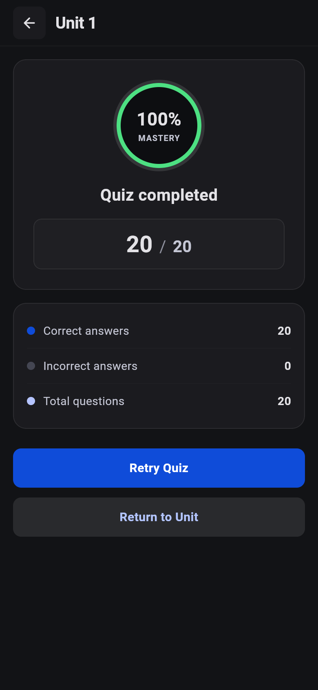
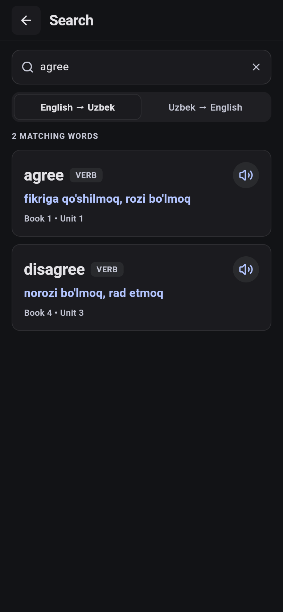
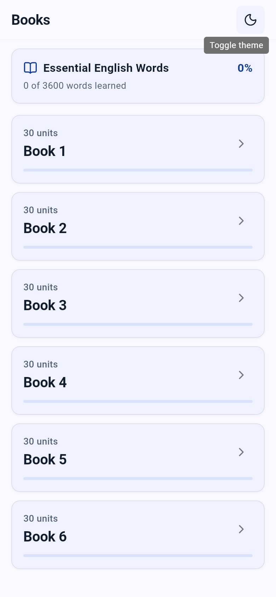

# Essential Words

**Build your English vocabulary, one unit at a time.**

Essential Words is an English–Uzbek vocabulary learning app built with Flutter. Explore 3,600 words, listen to their pronunciation, practice with animated flashcards, and test your understanding in both languages. Your learning progress stays saved on your device, so you can pick up where you left off.

**6 books · 180 units · 20 words per unit · Light and dark themes**

## Screenshots

Actual app screens, captured at a mobile viewport size.

<table>
  <tr>
    <td align="center"><br><strong>Book library</strong></td>
    <td align="center"><br><strong>Units and progress</strong></td>
    <td align="center"><br><strong>Learning modes</strong></td>
  </tr>
  <tr>
    <td align="center"><br><strong>Word review</strong></td>
    <td align="center"><br><strong>Flashcards</strong></td>
    <td align="center"><br><strong>Vocabulary quizzes</strong></td>
  </tr>
  <tr>
    <td align="center"><br><strong>Quiz results</strong></td>
    <td align="center"><br><strong>Dictionary search</strong></td>
    <td align="center"><br><strong>Light theme</strong></td>
  </tr>
</table>

## Features

- **A structured vocabulary library.** Six books with 30 units each. Every word includes its English spelling, Uzbek translations, and part of speech.
- **Word review.** Browse all 20 words in a unit, hear their pronunciation, and mark words as learned or return them to learning.
- **Flashcard practice.** Recall the meaning before revealing the translation with a smooth 3D flip. Practice words you have yet to learn and move through the deck at your own pace.
- **Two quiz directions.** Practice English → Uzbek or Uzbek → English with four answer choices, immediate feedback, a final score, and the option to try again.
- **Visible progress.** Track learned words and completion percentages for each unit, each book, and the full library. Changes update immediately and remain saved after restarting.
- **English pronunciation.** Listen to words using the device or browser's English (US) text-to-speech voice.
- **Bilingual dictionary.** Search English words or Uzbek translations across all six books and open a result's unit.
- **A comfortable interface.** Switch between light and dark themes, enjoy rounded cards and smooth touch ripples, and scroll with elastic, spring-back motion across platforms. Flashcard flips respect the system's reduced-motion preference.
- **Learn without an account.** Vocabulary, fonts, and images are bundled with the app. Core study features work offline, and progress, theme preferences, and quiz history are stored locally.

Pronunciation availability depends on the platform's speech engine and installed English voices. An offline voice is needed for offline pronunciation; Linux currently has no pronunciation implementation.

## How to study

1. Choose a book and open a unit.
2. Use **Review All Words** to read translations and listen to pronunciation.
3. Open **Practice Flashcards** to recall words before revealing their meanings. Mark familiar words as **Learned**.
4. Take a quiz in either direction and review your score.
5. Continue through the units while your progress grows.

Flashcard sessions start with the unit's unlearned words. Words marked learned remain available for the current session and are excluded the next time you open the deck. You can always revisit every word through word review. Quiz scores are separate from learned-word progress.

## Getting started

Use **Flutter 3.50 or newer** with **Dart 3.14 or newer**, plus the toolchain for your target platform. Run these commands from the project directory:

```sh
flutter pub get
flutter run
```

To run in Chrome:

```sh
flutter run -d chrome
```

The project includes Android, iOS, web, Windows, macOS, and Linux targets. iOS and macOS builds require macOS and Xcode; desktop builds require the corresponding platform's Flutter tooling.

### Dictionary and direct links

The dictionary is available at the `/search` route. In a web deployment, append `/#/search` to the app's base URL.

On Android and iOS, the custom URL scheme can open specific screens:

| Destination | Link |
| --- | --- |
| Dictionary | `essentialenglishwords:///search` |
| Book 1 units | `essentialenglishwords:///units/1` |
| Book 1, Unit 1 | `essentialenglishwords:///unit/1/1` |
| Word review | `essentialenglishwords:///learn/1/1` |
| Flashcards | `essentialenglishwords:///flashcards/1/1` |

Use three slashes after the scheme so the complete route reaches the app.

## Build and verify

```sh
flutter analyze
flutter test
```

Tests cover vocabulary integrity, search, quiz generation, saved progress, study flows, flashcard animation, ripple feedback, and elastic scrolling.

Build an Android APK or a web release:

```sh
flutter build apk --release
flutter build web --release --no-web-resources-cdn
```

The web command bundles rendering resources locally. Serve `build/web` using a web server. Android uses application ID `uz.essentialwords.flutter`; configure your own release signing key before distributing through an app store.

## Project structure

| Path | Contents |
| --- | --- |
| `lib/screens/` | Library, units, study modes, quizzes, results, and search |
| `lib/widgets/` | Reusable cards, buttons, headers, progress indicators, and flip animation |
| `lib/models/` | Vocabulary, progress, and quiz models |
| `lib/services/` | Vocabulary loading, local storage, and pronunciation |
| `lib/state/` | Shared learning progress and theme state |
| `lib/theme/` | Colors, typography, transitions, and scrolling behavior |
| `assets/data/books/` | Six bundled vocabulary books |
| `assets/fonts/` | Bundled fonts and their license files |
| `docs/screenshots/` | App screenshots used in this README |
| `test/` | Unit and widget tests |

Built with Flutter and Dart, using `material_ui` for Material components, `shared_preferences` for local persistence, `flutter_tts` for pronunciation, and `lucide_icons_flutter` for icons.
